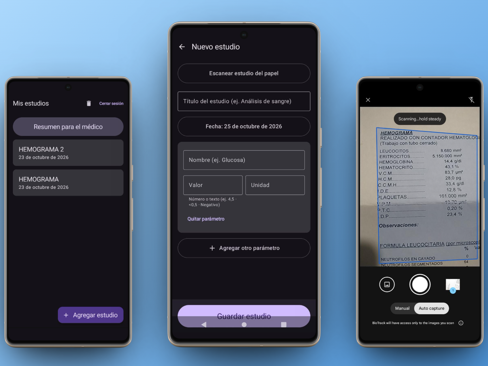
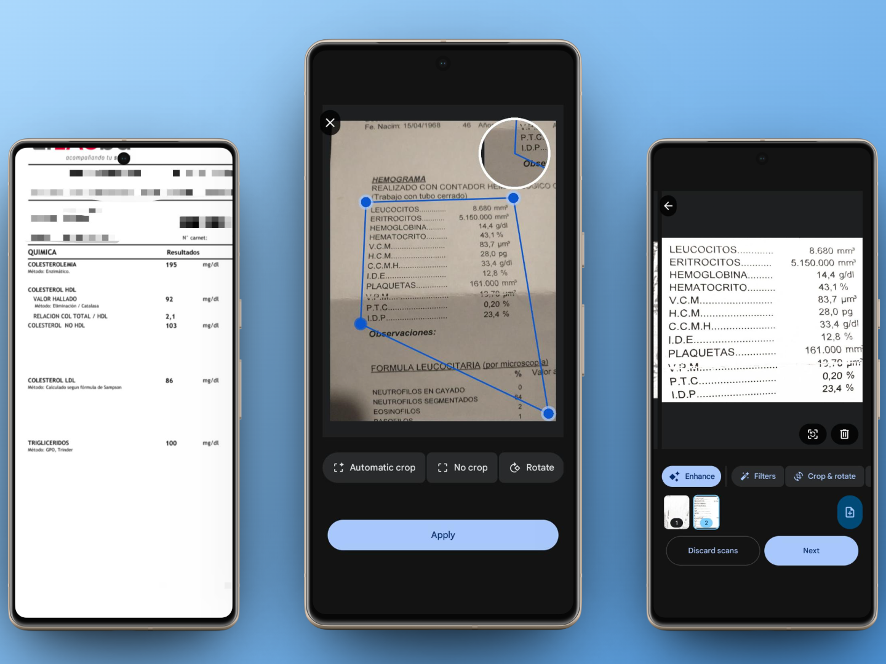
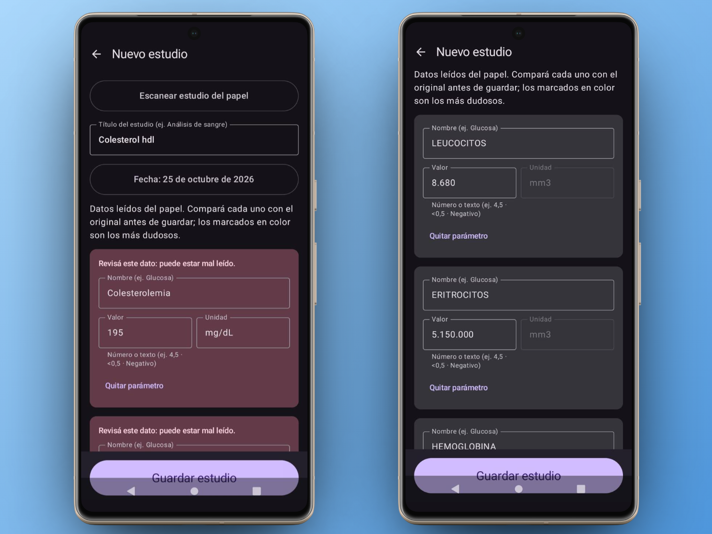
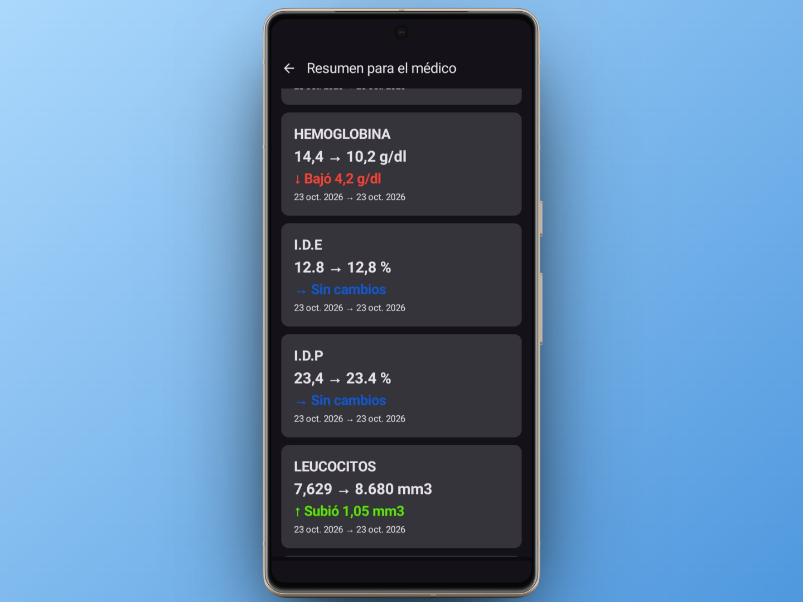

# BioTrack

Android app for saving biochemical test results and comparing them with previous ones. It's a direct source of information to show your doctor how your tests have changed over time, replacing piles of paper or endless PDFs.

> [!NOTE]
> This is a test version. The final version, with a more polished interface, is still in development.

## Features

- Manual entry of tests, with title, date, and values.
- Test scanning with the camera or from an image.
- Each value is compared with the previous test: went up, went down, or stayed the same.
- Google sign-in, to access your data from another phone.
- Works offline and syncs when the connection is back.


## 1. Home

When opening the app, the user chooses how to enter their data: **manually** or by **scanning** the test.




## 2. Scanning

You can scan the test directly on paper with the camera, or choose an existing image that contains the data.



## 3. Data entry

Manual entry gives you more control over each value. The scanner recognizes values with good accuracy and leaves them ready to review and correct before saving.



## 4. Comparison

Each value is compared with the previous test and shows whether it **went up**, **went down**, or **stayed the same**, along with the save date and the difference.



## Getting Started

1. Clone the repository and open it with Android Studio:

   ```bash
   git clone https://github.com/SantiagoGrinblat/BioTrack
   ```

2. Create your own project in [Firebase](https://console.firebase.google.com) and register the Android app with the project's package name.
3. Enable **Authentication** (Google provider) and **Firestore**.
4. Download your `google-services.json` and place it in the `app/` folder. It is not included in the repository.
5. Add the debug SHA-1 in the app settings in Firebase (otherwise Google sign-in fails). You can get it with:

   ```bash
   ./gradlew signingReport
   ```

6. In Firestore, set these security rules so each user can only access their own data:

   ```
   rules_version = '2';
     service cloud.firestore {
       match /databases/{database}/documents {
         match /users/{uid}/{document=**} {
           allow read, write: if request.auth != null && request.auth.uid == uid;
         }
       }
     }
   ```

7. Run the app from Android Studio.

## Technologies

Kotlin · Jetpack Compose · Firebase Auth · Firestore · ML Kit

## Disclaimer

BioTrack does not interpret results or provide reference ranges. It is a tool to keep and show your data; interpretation is up to the doctor.

## Author

**Santiago Grinblat** · [GitHub](https://github.com/SantiagoGrinblat) · [LinkedIn](https://linkedin.com/in/santi-grin)

## License

MIT
