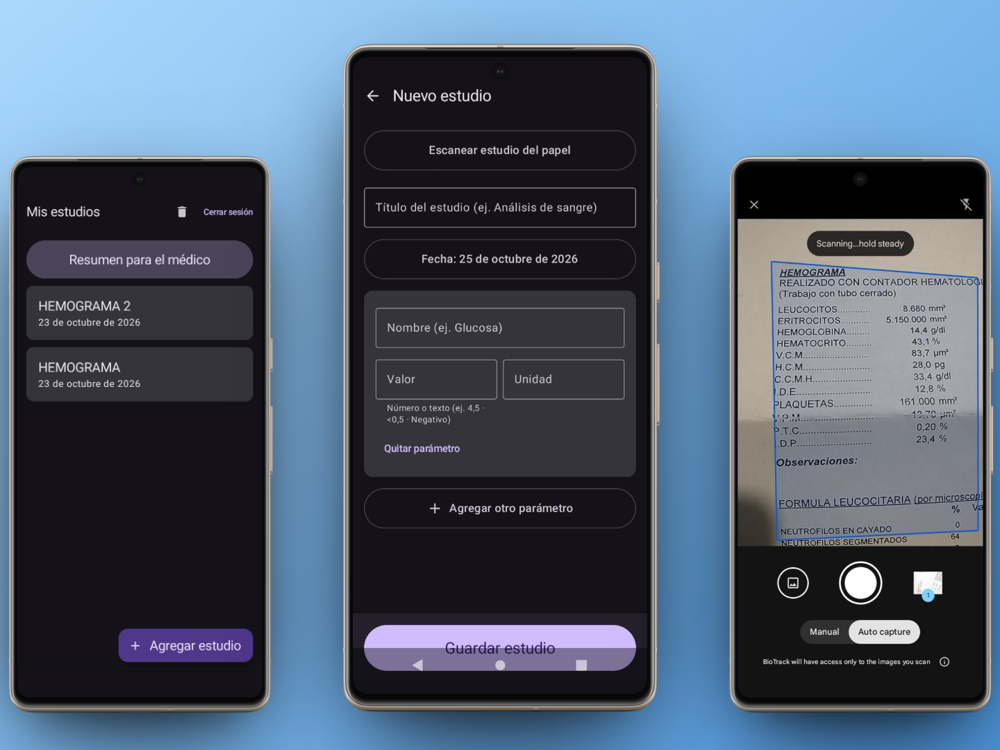
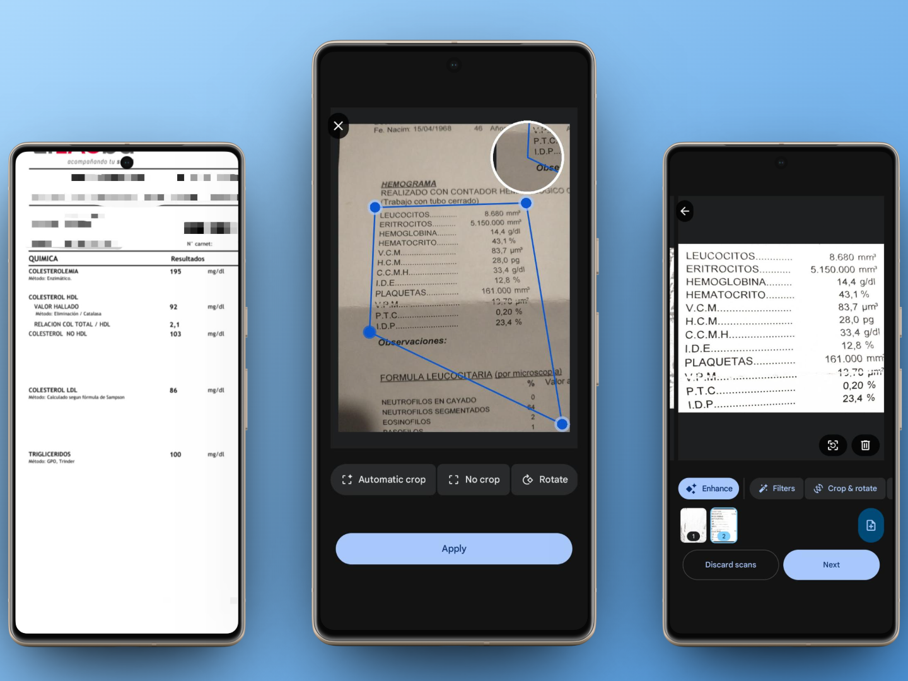
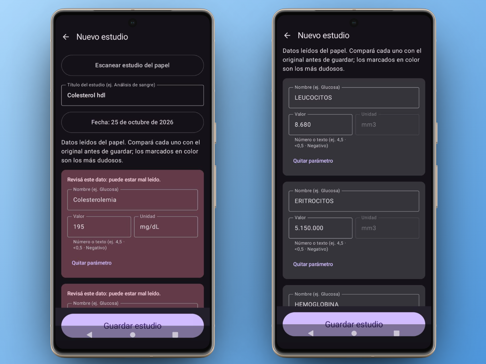
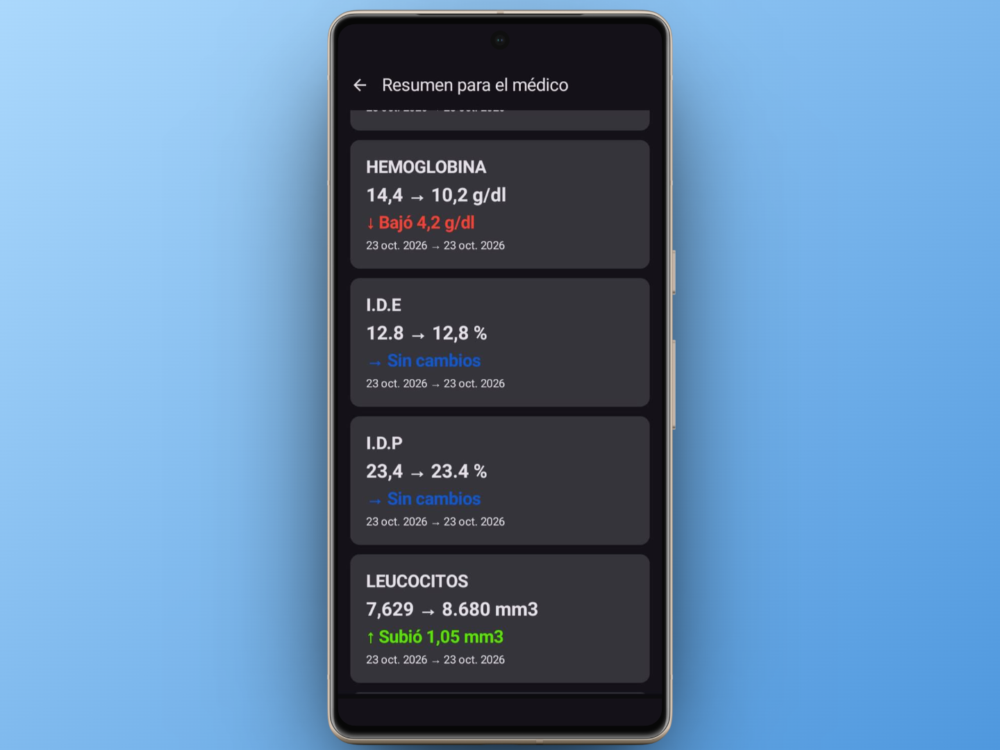

# BioTrack

App Android para guardar resultados de estudios bioquímicos y compararlos con los anteriores. Es una fuente directa de información para mostrarle al médico cómo cambiaron tus estudios con el tiempo, y reemplaza las pilas de papeles o los PDFs interminables.

> [!NOTE]
> Esta es una versión de prueba. La versión final, con una interfaz más cuidada, sigue en desarrollo.

## Funciones

- Escaneo de estudios con la cámara o desde una imagen guardada en su dispositivo. Los datos escaneados siempre pasan al formulario para revisarlos, nunca se guardan directamente.
- Carga manual de estudios en caso de errores de escaneo: título, carpeta a la que es asignada, método de estudio, descripcion, fecha y valores (números, texto o tiempo en minutos/segundos).
- Catálogo local de estudios (hemograma, orina, hepatograma y más) para reconocer nombres y parámetros aunque cada laboratorio los escriba distinto.
- Cada valor se compara con el anterior: subió, bajó o se mantuvo.
- Resumen para el médico: todos tus estudios en una sola pantalla dividido en carpetas para mostrar en la consulta de forma ordenada.
- Edición y borrado de estudios guardados.
- Inicio de sesión con Google, para acceder a tus datos desde otro celular.
- Funciona sin conexión y sincroniza cuando vuelve internet.


## 1. Lista de estudios

Tus estudios guardados en un solo lugar. Desde acá podés crear uno nuevo, editar o borrar.




## 2. Escaneo

Podés escanear el estudio directamente en papel con la cámara, o elegir una imagen que ya tengas con los datos, ademas reconoce imagenes de PDF



## 3. Revisión y carga de datos

La carga manual te da más control sobre cada valor. El escáner solo lee el texto (OCR); después los valores se comparan con el catálogo local y pasan al formulario, donde revisás y corregís lo que haga falta antes de guardar.



## 4. Comparación y resumen para el médico

Cada valor se compara con el estudio anterior y muestra si **subió**, **bajó** o **se mantuvo**, junto con la fecha de guardado y la diferencia. Todo se junta en un resumen pensado para mostrarle al médico.

> [!IMPORTANT]
> BioTrack no muestra valores de referencia ni interpreta resultados, para que nadie deje de consultar pensando que está todo bien. El análisis debe hacerlo siempre un profesional de la salud medico



## Cómo funciona el escaneo
1. ML Kit lee el texto en el dispositivo (OCR local, sin necesidad de internet).
2. Código propio en Kotlin detecta el tipo de estudio y compara cada línea con un catálogo JSON local (`assets/`).
3. El resultado pasa al formulario de nuevo estudio, con los campos a revisar marcados.

## Estudios reconocidos

BioTrack reconoce actualmente **4 tipos de estudio y 58 parámetros**. Se van sumando más con el tiempo.

<details>
<summary><b>Hemograma (13)</b></summary>

Glóbulos rojos, hematocrito, hemoglobina, VCM, HCM, CHCM, RDW, VPM, plaquetocrito, PDW, eritrocitos nucleados, reticulocitos y RDW-SD.

</details>

<details>
<summary><b>Examen de orina (20)</b></summary>

Color, aspecto, densidad, pH, proteínas, glucosa, cetona, hemoglobina, pigmentos biliares, urobilina, esterasa leucocitaria, nitritos, células epiteliales escamosas, células epiteliales no escamosas, leucocitos, leucocitos agregados, hematíes, cilindros, filamentos de mucus y cristales.

</details>

<details>
<summary><b>Hepatograma (13)</b></summary>

- **Bilirrubinas:** total, directa e indirecta.
- **Enzimas:** TGO, TGP y fosfatasa alcalina.
- **Proteínas:** proteínas totales y albúmina.
- **Lípidos:** colesterol total, HDL, LDL, triglicéridos y Castelli.

</details>

<details>
<summary><b>Estudios extras (12)</b></summary>

- Ferritina.
- Urea, creatinina, ácido úrico, PSA total y glucemia.
- **Coagulograma:** tiempo de coagulación, tiempo de sangría, tiempo de protrombina y KPTT.
- **Ionograma:** sodio y potasio.

</details>

Los nombres de estudios y parámetros provienen de laboratorios de Argentina y Latinoamérica, por eso un mismo valor se reconoce aunque cada laboratorio lo escriba distinto.

## Primeros pasos

1. Cloná el repositorio y abrilo con Android Studio:

   ```bash
   git clone https://github.com/SantiagoGrinblat/BioTrack
   ```

2. Creá tu propio proyecto en [Firebase](https://console.firebase.google.com) y registrá la app Android con el package name `com.santidev.biotrack`.
3. Activá **Authentication** (proveedor Google) y **Firestore**.
4. Descargá tu `google-services.json` y ponelo en la carpeta `app/`. No está incluido en el repositorio.
5. Agregá el SHA-1 de debug en la configuración de la app en Firebase (si no, el inicio de sesión con Google falla). Lo podés obtener con:

   ```bash
   ./gradlew signingReport
   ```

6. En Firestore, configurá estas reglas de seguridad para que cada usuario acceda solo a sus propios datos:

   ```
   rules_version = '2';
     service cloud.firestore {
       match /databases/{database}/documents {
         match /users/{uid}/{document=**} {
           allow read, write: if request.auth != null && request.auth.uid == uid;
         }
       }
     }
   ```

7. Ejecutá la app desde Android Studio.

## Aviso

BioTrack no interpreta resultados ni muestra rangos de referencia. Es una herramienta para guardar y mostrar tus datos; la interpretación le corresponde al médico.

El escaneo puede cometer errores de lectura (por ejemplo "O" en lugar de "0"), así que revisá siempre los valores antes de guardar.

## Autor

**Santiago Grinblat** · [GitHub](https://github.com/SantiagoGrinblat) · [LinkedIn](https://linkedin.com/in/santi-grin)

## Licencia

MIT
